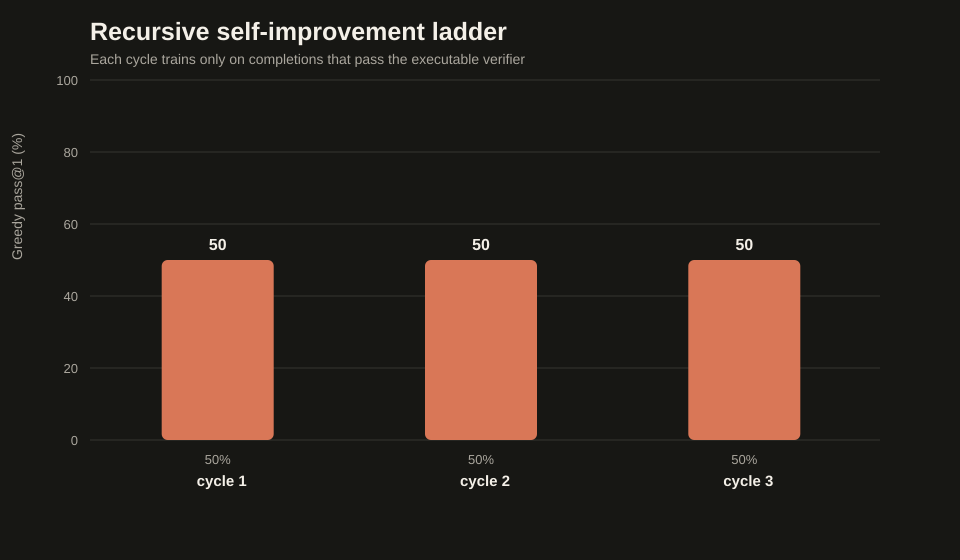

# Build a GLM-Style Hybrid-MoE Model From Scratch — With Recursive Self-Improvement

A readable 25.7M-parameter language model inspired by GLM-5.3-Flash: pretrained from random initialization on a synthetic Python corpus, improved with executable-reward RLOO, then improved again by a **recursive self-improvement ladder that trains the model on its own verified programs**. Includes a GLM-faithful miniature vision path, CPU-scale research experiments, an interactive slide deck, and SHA-256-audited receipts for every run. CUDA, Apple Silicon MPS, and CPU.



## Headline result (real runs, receipts included)

The pretrained model solved 5 of 6 held-out coding families greedily. A recursive self-improvement ladder targeting the failing family (`even`) sampled completions, kept only the ones that passed the executable verifier, and fine-tuned on them:

| | Held-out `even` | Other 5 families | Total |
|---|---|---|---|
| Pretrained step-150 | 0/2 | 5 passing | 5/6 |
| After RSI cycle 1 (2 verified programs) | **1/2** | 0 passing | 1/6 |
| After RSI cycle 3 (4 verified programs) | **1/2** | 2 passing | 3/6 |

The model taught itself a new family from 4 self-generated, machine-verified programs — and forgot three others doing it (catastrophic interference, measured and visible in `EXAMPLES.md`: it started emitting `x % 2 ==== 0` for `square`). Both effects are the result; neither is hidden. See [`REPORT.md`](REPORT.md).

## What was built

| Component | Released GLM-5.3-Flash | This project |
|---|---:|---:|
| Total parameters | 320B | 25,730,592 |
| Active parameters/token | 18B | 9,805,344 |
| Layers | 45 | 12 (9 linear + 3 sparse attention) |
| Attention | hybrid linear/sparse, KDA | ELU+1 linear + gathered sparse |
| Routed experts | 288, top-8 | 8, top-2 + 1 shared |
| Residual streams | multi-stream mHC | 4 learned streams, simplified |
| Tokenizer | BPE, 154,880 | raw UTF-8 bytes, 260 |
| Context | up to 1M | 192 bytes |
| Modalities | text, image, video | text + fixed 32×32 RGB |

## The three training stages

```text
1. PRETRAIN   next-byte prediction on procedural Python; 150 steps: loss 5.55 -> 0.43
2. RLOO       policy gradient with executable reward (leave-one-out baseline)
3. RSI        recursive self-improvement:
                propose  -> sample K completions per task
                verify   -> keep only completions that pass every hidden test
                distill  -> add to cumulative, deduplicated verified memory
                retrain  -> fine-tune on the model's own verified programs
                evaluate -> greedy pass@1 on frozen held-out tasks
                escalate -> (optional) unlock the next family rung
```

The verifier (`glm_mini/evaluator.py`) is fail-closed: one function, no imports/loops/attributes/recursion, allowlisted calls only, hidden tests in a restricted namespace. That gate is what makes self-generated data honest.

## Quick start

```bash
cd glm-mini-from-scratch
python3.12 -m venv .venv
source .venv/bin/activate        # Windows: .venv\Scripts\activate
python -m pip install -r requirements.txt
python -m pytest -q              # 37 tests
```

## Run everything

Windows (`run_cpu.bat`) and bash (`run_gpu.sh`) wrappers handle the venv for you:

```bash
# 1. pretrain (about 9 min CPU)
run_cpu.bat scripts\train_pretrain.py --output runs\pretrain-001 --steps 150 --checkpoints 50,100,150 --batch-size 16 --seed 42

# 2. recursive self-improvement on the failing family
run_cpu.bat scripts\train_self_improve.py --initial-checkpoint runs\pretrain-001\checkpoint-0150 --output runs\self-improve-even-001 --cycles 3 --families-ladder even --seed 73

# 3. charts from the receipts
run_cpu.bat scripts\make_charts.py --output artifacts\charts --pretrain-receipt runs\pretrain-001\training-receipt.json --self-improve-receipt runs\self-improve-even-001\training-receipt.json
```

Bash equivalents live in `scripts/`: `run_self_improvement.sh`, `run_rl_variant_screen.sh`, `run_experiment_suite.sh` (plus `.bat` twins for Windows).

## Evaluation

```bash
run_cpu.bat scripts\evaluate.py --checkpoint runs\self-improve-even-001\checkpoint-cycle-03 --split confirm --per-family 1 --families even,reverse,square,absolute,nonnegative,list_sum --output runs\confirm-after.json
run_cpu.bat scripts\evaluate_passk.py --checkpoint ... --split confirm --samples 8 --output runs\passk.json
```

## Vision path

A faithful miniature of the released image topology — RGB patch embedding, two bidirectional ViT blocks, learned 2×2 spatial merge, gated projector — splices 16 visual tokens into the byte sequence. Measured on generated digits (200 held-out):

| Architecture | After training |
|---|---:|
| GLM-faithful tower | 109/200 (54.5%) |
| Direct-patch baseline (labeled control) | 187/200 (93.5%) |

A bounded pilot attached the tower to the full 12-layer coding model and reached **45/100** held-out while training only 2.3M of 25.8M parameters. Details and honest caveats: [`VISION_REPORT.md`](VISION_REPORT.md), [`MULTIMODAL.md`](MULTIMODAL.md).

## Research experiments

CPU-scale matched studies with paired-seed analysis (`scripts/run_experiment_suite.sh` / `.bat`):

- **Data diversity** — 8 vs 32 vs 88 unique compositional structures at fixed compute. At this budget: no significant difference (reported, not spun).
- **Ordering & curriculum** — identical examples, interleaved vs blocked vs 8→88 curriculum. Interleaved led both seeds.
- **RL design screen** — one changed choice per arm, exact McNemar + Holm correction (`scripts/analyze_rl_variants.py`); a screen selects candidates, it does not establish results.
- **Vision pilot** — full-model integration with a bounded trainable surface.

Receipts and analyses: `artifacts/experiments/`, `artifacts/receipts/`.

## Slides

```bash
python slides/serve_slides.py --port 8765
# open http://127.0.0.1:8765/slides/slides.html
```

## Repository map

**Core (`glm_mini/`)**
- `model.py` — hybrid attention, MoE, residual streams, tied-head LM
- `self_improve.py` — the recursive self-improvement engine
- `vision.py` — GLM-style vision tower, projector, baseline
- `tasks.py` / `evaluator.py` / `tokenizer.py` / `runtime.py` — data, verifier, bytes, checkpoints + generation

**Scripts** — `train_pretrain.py`, `train_rl.py`, `train_self_improve.py`, `train_vision.py`, `evaluate.py`, `evaluate_passk.py`, `make_charts.py`, `analyze_rl_variants.py`

**Experiments** — `pretraining_data_diversity.py`, `pretraining_curriculum_order.py`, `full_25m_vision_digit_pilot.py`, plus analyzers

**Docs** — [`TUTORIAL.md`](TUTORIAL.md) (beginner course), [`REPORT.md`](REPORT.md) (method + results), [`EXAMPLES.md`](EXAMPLES.md) (real generations), [`VISION_REPORT.md`](VISION_REPORT.md), [`MULTIMODAL.md`](MULTIMODAL.md)

## Design rules

- **Determinism** — explicit seeds everywhere; tasks from pure integer hashes.
- **Fail-closed** — no overwrites; NaN hard-fails; unknown splits rejected.
- **Receipts** — versioned JSON with SHA-256 weight hashes for every entry point.
- **Device** — `--device auto` resolves cuda → mps → cpu; bf16 autocast only on CUDA.

## Limitations

25M parameters, 192-byte context, synthetic benchmark, single-seed comparisons at teaching scale. Self-improvement interference is documented, not solved. This is a teaching artifact: it establishes method, not broad ability.

## License

MIT.
